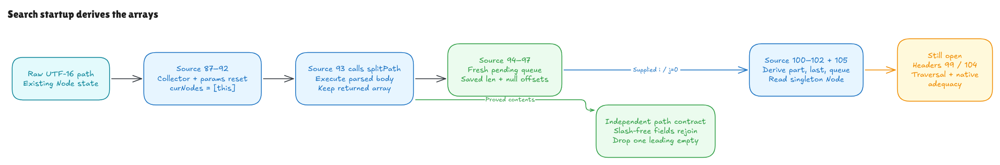

# Search startup: the path array comes from source

This milestone connects the beginning of Hono's `Node.search` to the earlier
iteration setup. The contiguous source at `node.ts`87–97 allocates the collector,
resets the receiver's params, creates its singleton node queue, calls the real
parsed `splitPath` body, allocates the pending queue, and saves length/null
offsets. The target remains Hono commit
`5ca49b0720755c585c9a9835f0a479ceea36fb52`.

[Editable Excalidraw source](../diagrams/search-setup.excalidraw) ·
[Live scene](https://app.excalidraw.com/s/8wot9n3ajqf/78xKsiN9oLc) ·
[Proof and evidence audit](search-setup-audit.md)

## What was missing

The previous iteration theorem received two existing arrays: path parts and
current nodes. It proved what Hono's indexed reads did with those arrays. The
earlier standalone `splitPath` theorem proved returned contents, but its runner
discarded the resulting heap. That observation was sufficient for checking a
utility's output. It could not explain which array the router subsequently read.

We now keep both the function's return value and its resulting state. An array
value identifies a particular allocated cell. The caller binds `parts` to that
value and reads its length from that cell. This connects the producer and its
consumer without constructing a replacement array between them.

## The four allocations

Startup produces these distinct arrays, in source order:

1. An empty `handlerSets` collector.
2. `curNodes`, containing exactly the current receiver.
3. The array allocated and returned by the actual `splitPath` body.
4. An empty `curNodesQueue` for later traversal.

Their freshness means they differ from earlier allocated array cells and from
one another. Existing arrays retain their contents through startup. The params
reset changes the receiver's writable private DATA slot; it preserves other raw
private entries, including METHOD tags. Public objects and the other modeled
state components have explicit frame conditions.

An empty path still causes the function to allocate an array. Its returned
contents are empty and the saved length is zero. We do not require a nonempty
path merely to make the theorem work.

## The path rule is independent of the program

The contract describes delimiter-separated UTF-16 fields. Before removing a
leading empty field, the fields contain no slash and rejoin to the original
input. The default split limit is applied, and one leading empty field is
removed. The contract does not call the source interpreter to define its answer.

| Raw path | Returned parts |
| --- | --- |
| `""` | `[]` |
| `"/"` | `[""]` |
| `"/users/"` | `["users", ""]` |
| `"//users"` | `["", "users"]` |
| `"users/profile"` | `["users", "profile"]` |

The underlying string model preserves UTF-16 units, including lone surrogates.
There is no decoding, normalization or URL parsing in this step.

## A call has effects before it returns

The explicit function-call entry evaluates the callee first, then arguments in
order. It resolves the saved function reference, installs the formal parameter
and captured scope, and runs the parsed body using the existing statement
semantics. On success it restores the caller's scope while retaining heap
effects and the returned value.

The call entry checks that its function-reference range does not overlap the
ordinary expression-function table or the supplied private-method table. The
conformance fixture supplies the latest table after both class definitions.
This check does not prove that arbitrary external function definitions have
been represented in the model.

The selected upstream `splitPath` is an arrow function with no `this` reads or
free-variable writes. This milestone uses an explicit module-scope closure
boundary. General live module bindings, closure installation and arbitrary
nested calls remain separate obligations. The call rule is not silently added
to every invocation in the older expression evaluator.

## How the later proof receives its inputs

The startup proof supplies the actual returned parts array and singleton node
array to the existing iteration contract. For a supplied in-range outer index
and inner index zero, source 100–102 derives the part, final-part flag and fresh
temporary queue; source 105 reads the receiver from the singleton array.

The index activations are explicit. Header 99 and header 104 have not been proved
to create or advance them. Source 100–102 and source 105 are separate windows
across the omitted inner header. This composition proves a real data handoff;
it does not yet prove search-loop reachability, traversal, parameter branches,
pending-queue progression, sorting or final match results.

There is also a checked nonempty example that continues through the full first
literal branch. It starts with a real registration and a stale private `id=7`
value installed by the earlier parsed source assignment. Startup resets that
pointer; the old value does not appear in the later captures. Its wildcard and
direct targets share one handler record, so both collector entries observe the
last params reset. This demonstrates the composed path on a concrete state;
the new universal handoff theorem stops at the source 105 node declaration.

The [audit](search-setup-audit.md) records the exact checked declarations,
source hashes, replay commands, comparison corpus and remaining trust boundary.
The [experiment overview](README.md) keeps this conditional
source result separate from whole-Hono verification.
